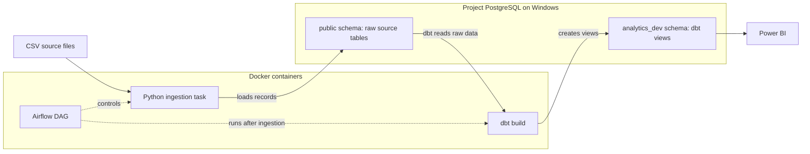

# Supply Chain Analytics Pipeline

## Project handover

This document explains the pipeline from source files to Power BI, the responsibilities of its Python, PostgreSQL, dbt, Airflow, and Docker components, and the checks used to verify a run. It is intended for an engineer taking over the project.

## 1. Purpose and outputs

The pipeline turns shipment, supplier, purchase-order, and inventory inputs into analytical views for delivery performance, supplier reliability, and inventory risk.

The current DataCo shipment dataset contains **180,519 order-item rows** and **65,752 distinct orders**. The order date range is **January 1, 2015 to January 31, 2018**; shipping dates range from **January 3, 2015 to February 6, 2018**.

## 2. Architecture and data flow



**Run order:** Airflow runs the Python ingestion task first. When that succeeds, it runs `dbt build`. Python loads raw records into PostgreSQL. dbt reads those raw tables and creates analytical views in PostgreSQL. Power BI reads the views.

The Docker boundary contains Airflow, the Python ingestion runtime, and dbt. The project PostgreSQL server is a separate Windows process. Airflow containers connect to it through Docker's host gateway. Power BI on Windows connects to it locally. Airflow also has its own internal PostgreSQL service for Airflow metadata; that is separate from the project database and does not hold the supply-chain analytics models.

## 3. Runtime and connection configuration

### Project PostgreSQL

| Setting | Value |
|---|---|
| Host from Windows applications | `localhost` |
| Host from Docker containers | `host.docker.internal` |
| Port | `5433` |
| Database | `supply_chain_dev` |
| Database user | `supply_admin` |
| Raw schema | `public` |
| dbt output schema | `analytics_dev` |

The database password is supplied through local environment/profile configuration and the Airflow connection. It must not be committed to the repository or written into this document.

### dbt profiles

- Local dbt profile: `%USERPROFILE%\.dbt\profiles.yml`.
- Airflow dbt profile: `airflow/config/dbt/profiles.yml`.
- The Airflow profile reads connection values from environment variables. The DAG supplies them from the Airflow connection named `supply_chain_postgres`.
- The Airflow image keeps dbt in an isolated environment at `/home/airflow/dbt-venv`.

## 4. Database layers and model grain

### Raw layer: `public`

Raw tables preserve source records for downstream transformation:

- `raw_supply_chain_orders`: one JSON record per source order-item row; 180,519 rows after the recorded load.
- `raw_synthetic_suppliers`: supplier source records.
- `raw_synthetic_purchase_orders`: purchase-order source records.
- `raw_synthetic_inventory_snapshots`: inventory snapshots keyed by snapshot date and product.

The source row grain matters: the DataCo source is at **order-item** level. One order may therefore appear on multiple rows. Order counts should use distinct order IDs or an order-level model; summing item rows as though each were a separate order will overcount orders.

### dbt layer: `analytics_dev`

The dbt models are configured as **views**. A view stores a SQL definition in PostgreSQL and returns results when queried; it is not a separately stored table copy.

| View | Purpose / grain |
|---|---|
| `stg_order_items` | Cleaned shipment/order-item records; one row per order item |
| `stg_products` | Product reference data; one row per product ID |
| `stg_synthetic_suppliers` | Supplier reference data; one row per supplier ID |
| `stg_synthetic_purchase_orders` | Cleaned purchase-order records; one row per purchase order |
| `stg_synthetic_inventory_snapshots` | Inventory records by snapshot date and product |
| `int_orders` | Order-level delivery data; one row per order ID |
| `mart_monthly_delivery_performance` | Delivery measures grouped by order month |
| `mart_delivery_by_shipping_mode` | Delivery measures grouped by shipping mode |
| `mart_delivery_by_region` | Delivery measures grouped by order region |
| `mart_supplier_reliability` | Supplier delivery and quantity-fill measures, grouped by supplier |
| `mart_inventory_stockout_risk` | Product inventory, demand, cover, and reorder indicators, grouped by product |

The marts are already aggregated for their stated reporting grain. Use them independently for summary visuals. Avoid joining a monthly or regional aggregate to another aggregate unless the join keys and resulting grain are intentional.

## 5. dbt project components

The dbt project is under `supply_chain_analytics/`.

- `dbt_project.yml`: project identity, model paths, and default materializations.
- `models/**/sources.yml`: declares the existing raw PostgreSQL tables as dbt sources. Models use `source(...)` to read them.
- SQL files under `models/`: define staging, intermediate, and mart views. Models use `ref(...)` to depend on other dbt models; these references form the build graph.
- Model property YAML files: document model/column properties and define data tests.
- `tests/`: space for project-specific SQL tests; reusable generic tests are attached in YAML.
- `macros/`: reusable Jinja/SQL logic.

`dbt build` parses this project, resolves its dependencies, builds the selected models in dependency order, and runs their configured tests. A successful run means those operations completed; it does not prove rules that have no corresponding tests.

### Data tests

The project tests include:

- `not_null`: required identifiers or dates are populated.
- `unique`: a field expected to identify one row has no duplicates.
- `accepted_values`: a categorical field uses an allowed value, such as a shipping mode or binary risk flag.
- `relationships`: a foreign key such as purchase-order supplier/product ID exists in the referenced model.

The latest recorded project-wide dbt test run passed **32 tests**. Re-run tests after changing model SQL, source definitions, or business rules.

### Important metric distinction

`Late_delivery_risk` is a risk flag in the source data. Actual lateness is a separate delivery outcome. Keep these as separate measures in models and dashboards; a risk flag should not be presented as the count of orders that were actually late.

## 6. Python and Airflow components

### Ingestion scripts

| File | Responsibility |
|---|---|
| `load_dataset.py` | Loads the DataCo CSV into `raw_supply_chain_orders`; excludes customer email and password fields. |
| `load_synthetic_sources.py` | Loads supplier and purchase-order CSVs into their raw tables. |
| `load_inventory_snapshot.py` | Loads inventory snapshots into the raw inventory table. |
| `generate_demo_purchase_orders.py` | Generates the purchase-order CSV input. |
| `generate_demo_inventory.py` | Generates the inventory snapshot CSV input. |
| `airflow/scripts/ingest_sources.py` | Pipeline ingestion entry point used by Airflow; loads the mounted CSV inputs into PostgreSQL. |

The root-level loader and generation scripts support development and preparation. The Airflow DAG uses `airflow/scripts/ingest_sources.py` as its ingestion entry point.

The DataCo reload replaces the rows associated with that source file within a database transaction. Supplier, purchase-order, and inventory loaders use conflict handling/upserts on their keys so reruns update existing records instead of making duplicate keyed rows. Confirm the expected row counts after ingestion.

### Airflow DAG

- DAG file: `airflow/dags/supply_chain_pipeline.py`.
- DAG ID: `supply_chain_pipeline`.
- Schedule: manual (`schedule=None`). Trigger it from the Airflow web interface when a pipeline run is required.
- Task 1, `ingest_sources`: invokes `python /opt/airflow/scripts/ingest_sources.py`.
- Task 2, `dbt_build`: invokes dbt from `/home/airflow/dbt-venv/bin/dbt`, using the mounted dbt project and profile.
- Dependency: `ingest_sources >> dbt_build`; dbt starts only after ingestion succeeds.

Airflow is the orchestrator: it records task state, order, logs, retries, and run history. The Python script performs ingestion; dbt performs SQL transformations and tests.

## 7. Repository file map

```text
supply-chain-pipeline/
├── airflow/
│   ├── dags/supply_chain_pipeline.py
│   ├── scripts/ingest_sources.py
│   ├── config/dbt/profiles.yml
│   ├── Dockerfile
│   ├── requirements.txt
│   └── docker-compose.yaml
├── data/
│   ├── suppliers.csv
│   ├── purchase_orders.csv
│   └── inventory_snapshots.csv
├── supply_chain_analytics/
│   ├── dbt_project.yml
│   ├── models/
│   ├── tests/
│   └── macros/
├── load_dataset.py
├── load_synthetic_sources.py
├── load_inventory_snapshot.py
├── generate_demo_purchase_orders.py
└── generate_demo_inventory.py
```

The large DataCo CSV is stored in the local Kaggle cache and mounted into the Airflow container from the host; it is not necessary to commit that large file to Git. Keep credentials, `.env` files, local database files, virtual environments, generated logs, and dbt `target/` artifacts out of version control. Keep `requirements.txt`, Dockerfile, Compose configuration, SQL models, YAML configuration without secrets, and DAG/script code under version control.

## 8. Operating the pipeline

### Start the services

On the Windows machine, first start the project PostgreSQL server if it is stopped. In **VS Code's PowerShell terminal**, from the project root:

```powershell
& "C:\Program Files\PostgreSQL\18\bin\pg_ctl.exe" -D "$env:LOCALAPPDATA\SupplyChainPostgres\data" -l "$env:LOCALAPPDATA\SupplyChainPostgres\postgres.log" start
```

Then, in the same VS Code PowerShell terminal, enter the Airflow folder and start Docker Compose:

```powershell
Set-Location C:\Users\Admin\projects\supply-chain-pipeline\airflow
docker compose up -d
docker compose ps
```

Open Airflow at `http://localhost:8080`, locate `supply_chain_pipeline`, and trigger a run. Check that both `ingest_sources` and `dbt_build` are successful. Open the task log to investigate any failure.

### Verify the output

1. **Airflow:** DAG run succeeded; both tasks succeeded; review task logs if not.
2. **Raw PostgreSQL:** row counts for all four raw tables are as expected; no partial load occurred.
3. **dbt:** expected models were built and tests passed. For local development, run from the dbt project directory using the project's `.venv`: `dbt debug` checks configuration/connection and `dbt build` builds models and runs tests.
4. **PostgreSQL views:** query the marts and compare totals/date ranges to prior known results or source-level checks.
5. **Power BI:** refresh succeeds; validate order counts and key metrics against database queries before publishing or sharing a report.

A green Airflow run indicates successful task execution. Data completeness and business correctness also require row-count, test, and metric checks.

## 9. Troubleshooting guide

| Symptom | First place to check | Typical cause / next check |
|---|---|---|
| DAG is not visible | Airflow DAG list and DAG processor logs | Confirm the DAG file exists under `airflow/dags` and the mounted directory is correct. |
| Ingestion task fails | `ingest_sources` task log | Check source file paths/mounts, PostgreSQL availability, connection values, table schema, and encoding. |
| dbt task fails to connect | `dbt_build` task log | Check the Airflow connection `supply_chain_postgres`, the `host.docker.internal` route, port, database, and PostgreSQL access rules. |
| dbt reports a missing source or relation | dbt parse/build output | Check `sources.yml`, source table names/schema, and that ingestion created/populated the raw tables. |
| dbt test fails | Failed test name and compiled SQL in task logs | Inspect failing rows and decide whether data or the business rule/model needs correction. |
| Power BI cannot connect | Power BI data source settings and PostgreSQL status | From Power BI on Windows use `localhost` and port `5433`, database `supply_chain_dev`; select `analytics_dev` views. |
| Docker services are stopped/unhealthy | Docker Desktop and `docker compose ps` | Check container logs and available Docker resources. Remember Airflow's internal PostgreSQL is not the project database. |

## 10. Security and handover notes

- Do not place database passwords in SQL, Python, YAML, screenshots, or Git commits.
- Use the local dbt profile for local runs and the Airflow connection/environment variables for container runs.
- Customer email and password fields are excluded by the DataCo ingestion code.
- The project PostgreSQL service must be running before Airflow tasks or Power BI can connect to it.
- The DAG is manually triggered; it does not run on a time schedule.
- The project has been validated with successful dbt model builds, a 32-test pass, and a successful Airflow run. Re-run the relevant checks after code or data changes.
